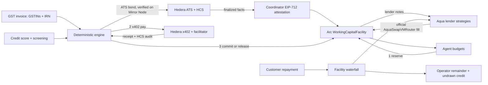

# Autonomous Working Capital System

Receivables-backed working capital for teams of AI agents. One GST-verified invoice sets a shared USDC credit ceiling, agents spend from reserved sub-budgets through x402 on Hedera, and customer revenue repays lenders before the operator.

**One verified receivable, one shared credit ceiling, many agents.**

- **Verify.** The invoice is checked against India's GST rules: both GSTINs (format, state code, check digit), different legal entities, and the e-invoice IRN. The buyer does nothing. The invoice gets one canonical ID and an ATS receivable bond on Hedera, so it can never be financed twice. Foreign invoices use the seller and buyer tax IDs and the invoice number, at a lower advance.
- **Score.** A deterministic credit score (300–900) from repayment history and agent behaviour sets the credit limit and advance rate. New borrowers start at $1,000 and step up with each on-time repayment.
- **Fund.** The borrowing base is the face value times the lowest of the requested advance, the credit tier's cap and the evidence cap: 75% ($7,500) in the demo. 1inch Aqua lender strategies are filtered by their risk rules and filled cheapest-first. The fills go through the **official AquaSwapVMRouter**, and lenders receive credit notes.
- **Spend.** The Arc facility holds the USDC. Each agent payment is reserved on Arc, paid through x402 on Hedera, then committed (or released on failure or timeout).
- **Repay.** The customer pays into the facility's fixed repayment waterfall. Lenders receive principal plus fee, pro rata, before the operator receives anything. Paid on time, the score goes up. Seven days late freezes spending, 30 days late is a default, and repayments still reach lenders first.

Step-by-step account and key setup is in [`docs/SETUP_GUIDE.docx`](docs/SETUP_GUIDE.docx). Eligibility, the credit score and the compliance policies are in [`docs/COMPLIANCE.md`](docs/COMPLIANCE.md), and the pitch is in [`docs/PITCH.md`](docs/PITCH.md). The build plan is [`docs/PLAN.md`](docs/PLAN.md), and the product brief is [`docs/Autonomous_Working_Capital_System.docx`](docs/Autonomous_Working_Capital_System.docx).

## What is real and what is simulated

| Layer | Implemented | Verified here | What still needs your credentials |
|---|---|---|---|
| Deterministic engine (Python) | Lifecycle `DRAFT → VERIFIED → TOKENIZED → FUNDING → ACTIVE → REPAID`, plus `OVERDUE`, `DEFAULTED` and `DISPUTED`; canonical IDs, stale claims, offer eligibility, cheapest-first allocation, five independent spend policies, reserve/commit/release, partial-repayment waterfall, append-only event log | 78 unit/service/API tests | — |
| GST verification and eligibility | GSTIN format, state code and check digit; same-PAN self-invoice block; offline IRN match; four evidence tiers with advance caps; B2B-only, no personal loans, tax invoices only, due within 120 days | Unit tests incl. the published GSTIN check-digit example | Live IRN lookup needs a GSP/IRP API account (future work); the demo IRN is labelled simulated |
| Credit score | 300–900 from on-time, late and defaulted repayments plus agent payments and policy rejections; five tiers set limit and advance; history persists per borrower | Unit + service tests (demo goes 740 → 760) | — |
| Compliance gates | KYC/KYB, sanctions screening (fictional demo list), lender allowlist, merchant screening, admin pause that never blocks repayment, hashes-only public records, overdue/default/dispute | Engine, API and contract tests | A real screening provider and KYC vendor |
| Arc facility (Solidity) | EIP-712 coordinator attestations with expiry and replay protection, borrowing base, duplicate-receivable lock, non-transferable lender notes, budgets, per-tx/daily/merchant limits, timeout release, pro-rata waterfall, pause, approved lenders, blocked addresses, permissionless overdue/default marking, dispute freeze | 38 unit + fuzz tests, 4 invariants over 8,192 calls | Arc Studio project and Arc testnet deployment |
| 1inch Aqua / SwapVM | `RECEIVABLE_CREDIT_V1` lender strategy (salt-bound terms, deadline, 1 bp 1:1 band). Lenders `ship` USDC; the facility fills them through the official router | Full flow on a **local Anvil fork of Arc mainnet (5042)** against the real Aqua registry `0x1111113c…` and router `0x11111133…`, using a labelled **TestUSDC** | Nothing for the fork. Aqua is not deployed on Arc testnet (5042002) |
| Hedera x402 | Autonomous x402 client, $0.25 USDC paid resource, localhost gateway with durable idempotency and reconciliation lookup | Typecheck and unit tests only | Funded testnet payer, merchant, HCS topic (see guide) |
| Hedera HCS / HCS-14 | Audit publisher with sequence numbers, lifecycle audit events, HCS-14 UAIDs (AID method, per spec), profile publishing script | UAID algorithm cross-checked in TS and Python | HCS topic and operator key |
| Hedera ATS | Bond request builder (bytes32 config ID fixed), Mirror Node verification of the issuer-submitted bond | Typecheck | ATS issuance from your issuer wallet in the ATS web app |
| Dashboard | Verify/Fund/Spend/Repay rail, GST check list, credit and compliance panel, live/simulated labels everywhere, Aqua fill evidence, x402 receipt, both policy rejections, partial repayment, waterfall, score change, live activity over SSE | Browser E2E (Playwright) against the Arc fork: full flow, score 740 → 760, keyboard reset, no console errors, no overflow at 390 px | — |

Anything simulated is labelled in the UI, the API and here. Arc's native USDC cannot be transferred on Anvil because it depends on an Arc-specific precompile, so the fork uses `TestUSDC` alongside the real Aqua contracts.

## Who can use it

| Who | Eligible? |
|---|---|
| Company or partnership invoicing a business | Yes |
| Freelancer (sole proprietor) invoicing a business | Yes. Without a GSTIN, at the lowest tier (30% advance) |
| Foreign business with seller and buyer tax IDs | Yes, at a 50% advance cap |
| Individual without a business invoice | No: personal loans are out of scope |
| Invoices to consumers, credit notes, invoices already due or due in more than 120 days | No |
| An AI agent on its own | No. Agents spend from budgets; the verified owner is the borrower |

Every borrower needs KYC/KYB and a clean sanctions screen, and new borrowers start small:

| Tier | Score | Limit | Highest advance |
|---|---|---|---|
| Trusted | 800+ | $25,000 | 80% |
| Established | 700–799 | $10,000 | 75% |
| Building | 600–699 | $3,000 | 60% |
| Starter (new borrowers start at 550) | 450–599 | $1,000 | 50% |
| Blocked (or any unresolved default) | below 450 | $0 | 0% |

The advance is also capped by the evidence: GST e-invoice with a matching IRN 80%, GSTIN only 50%, foreign invoice 50%, freelancer without GSTIN 30%. Details and the full policy list: [`docs/COMPLIANCE.md`](docs/COMPLIANCE.md).

## Quick start (simulated, no keys)

Requirements: Node.js 22+, Python 3.11+.

```sh
cp .env.example .env
npm install
python3 -m venv services/orchestrator/.venv
services/orchestrator/.venv/bin/pip install -r services/orchestrator/requirements.txt
npm run api:dev          # terminal 1 → http://localhost:8000
npm run dev              # terminal 2 → http://localhost:3000
```

## Real contracts: Arc fork with the official Aqua router

Requires [Foundry](https://getfoundry.sh).

```sh
npm run contracts:setup  # once: installs forge-std and OpenZeppelin into contracts/arc/lib
npm run contracts:build  # compiles and exports ABIs to packages/shared/abi
npm run arc:fork         # terminal A: Anvil fork of Arc mainnet, chain 5042
npm run arc:fork:setup   # deploys TestUSDC + facility; Alice, Bob, Charlie ship Aqua strategies
npm run arc:fork:e2e     # optional: proves the whole flow on-chain from the command line
npm run arc:gateway      # terminal B: localhost Arc gateway on :4031
```

Set `ARC_EXECUTION_MODE=gateway` in `.env` and restart the API. The dashboard then funds through Aqua and sends every reservation, commit, release, repayment and status change (overdue, default, dispute) to the contract. Setup approves Alice, Bob and Charlie as KYC-verified lenders. Re-run `arc:fork:setup` whenever you restart Anvil; the gateway keeps a separate transaction ledger per deployment, so old receipts are never replayed.

With Docker: `docker compose --profile arc-fork up --build`, with `ARC_EXECUTION_MODE=gateway` set in `.env`.

## Live Hedera testnet

Follow the guide to create the accounts, then:

```sh
npm run hedera:testnet:setup     # associates USDC, creates the HCS topic, publishes HCS-14 profiles
npm run hedera:research:serve    # paid $0.25 resource
npm run hedera:x402:gateway      # localhost gateway the API calls
```

Set `HEDERA_PAYMENT_MODE=live` and `HEDERA_GATEWAY_API_TOKEN`, then restart the API. A spend commits on Arc only after a finalized Hedera receipt.

**ATS:** issue the single-unit USDC receivable bond in the ATS web app from your issuer wallet. Then run `npm run hedera:ats:verify -- <txId>` and set `HEDERA_ATS_ISSUANCE_TX_ID`. ATS signs only through a connected wallet, so issuance is never automated.

## Arc testnet deployment (Arc prize track)

```sh
cd contracts/arc
ARC_COORDINATOR_ADDRESS=0x… ARC_USDC_ADDRESS=0x3600000000000000000000000000000000000000 ARC_APPROVED_LENDERS=0x…,0x… \
  forge script script/Deploy.s.sol --rpc-url https://rpc.testnet.arc.io --broadcast --private-key $ARC_PRIVATE_KEY
```

Record the addresses in `deployments/arc-testnet.json` (same shape as `arc-fork.json`) and run the gateway with `ARC_MODE=testnet`. On testnet, lenders fund with `fundDirect`. Import or recreate the contract in **Arc Studio** and record the project URL below.

## Architecture



| Path | Role |
|---|---|
| `services/orchestrator` | FastAPI. `engine.py` holds the pure deterministic rules, `service.py` the two-phase orchestration and reconciliation, `store.py` the append-only event log and read model |
| `contracts/arc` | Foundry. `WorkingCapitalFacility.sol`, `LenderNote.sol`, tests, deploy script |
| `services/arc-gateway` | viem adapter: coordinator signer, facility client, fork setup, HTTP API |
| `services/aqua-gateway` | Official Aqua + SwapVM SDKs: offer selection, strategy builder, ship and fill calldata |
| `services/hedera-gateway` | x402 client and resource, HCS audit, HCS-14 UAIDs, ATS request and verification, testnet setup |
| `packages/shared` | Durable idempotency ledger, ABIs, demo fixture shared by TypeScript and Python |
| `apps/web` | Next.js dashboard |
| `tests/e2e` | Browser rehearsal |

### Trust assumptions

- **The coordinator.** Hedera and Arc are separate chains with no native atomic interop. The coordinator observes finalized Hedera facts and signs short-lived EIP-712 attestations that the contract verifies, with expiry and replay protection. Whoever holds the coordinator key is trusted to attest truthfully.
- **Not atomic.** A spend reserves on Arc, pays on Hedera, then commits. If the outcome is uncertain, the reservation stays held until reconciliation finds the settled receipt or the reservation times out. Releasing after a timeout is permissionless.
- **Only the engine decides.** The engine decides and the contract re-enforces the same rules. The ADK agent can only prepare issuance payloads and explain decisions.
- **GST proves the invoice was reported, not that it will be paid.** An IRN shows the seller registered the invoice with the tax system. It does not prove the buyer agreed or will pay. That risk is handled by small starting limits, the credit score, evidence-based advance caps, lenders being paid first, and default handling. Production would add recourse agreements and payment into a facility-controlled account.

## API additions

| Endpoint | Purpose |
|---|---|
| `POST /api/receivables/{id}/verify` | GST verification, eligibility, screening and credit score. Optional body `{"irn": "<64 hex>"}` for a real e-invoice IRN |
| `POST /api/facilities/{id}/assess` | Overdue/default check from the due date. Safe for anyone to call |
| `POST /api/facilities/{id}/dispute` | Freeze spending on a disputed invoice |
| `POST /api/facilities/{id}/dispute/resolve` | Admin: `{"upheld": true}` makes it a default, `false` resumes |
| `POST /api/admin/pause` | Admin: compliance pause. Repayments keep working |
| `GET /api/credit/{borrowerId}` | Score, tier, limit and next step |
| `GET /api/policies` | Eligibility rules, evidence tiers and compliance policies |

## Tests

```sh
npm test              # typecheck + TS unit tests + forge tests + Python tests
npm run e2e           # browser rehearsal (needs API + dashboard running; install: npm i --no-save playwright@1.63.0 && npx playwright install chromium)
npm run demo:reset    # reset the dashboard demo
```

## Demo numbers

- Invoice INV-2048 from Northstar Agents (GSTIN 27AABCN…1ZL, Maharashtra) to RetailCo (29AAECR…1ZI, Karnataka), $10,000, Net 30. The GSTINs are fictional and only pass the format and check-digit rules.
- GST e-invoice verified (80% evidence cap). Credit score 740, Established tier ($10,000 limit, 75% cap). The advance is 75%, giving a borrowing base of $7,500. The facility requests $6,000.
- Alice funds $4,000 at 7% and Bob $2,000 at 8.5%, through Aqua fills. Charlie at 13% is not needed.
- Research pays $0.25 through x402. Compute requests $5,500 against its $3,000 budget and gets `AGENT_BUDGET_EXCEEDED`. The lead agent requests $6,500 against $5,999.75 of remaining credit and gets `GLOBAL_CREDIT_LIMIT_EXCEEDED`.
- Customer pays $10,000. Lenders receive $6,036.98 (fees of $23.01 and $13.97, from APR × a 30-day minimum term), then the operator receives $3,963.01 plus the $5,999.75 of undrawn credit. Debt ends at $0.
- The credit score moves from 740 to 760: +40 for the on-time repayment, −20 for the two deliberate overspend attempts. One more on-time repayment reaches Trusted ($25,000).

The brief's flat $100 fee and its $5,500 → `GLOBAL_CREDIT_LIMIT_EXCEEDED` example were illustrative. The plan's term-based fee and separate global-limit request are what the code implements.

## Submission evidence (fill in as you go)

| Item | Value |
|---|---|
| Arc Studio project URL | |
| Arc testnet facility address | |
| Arc testnet transactions (open, fund, commit, repay) | |
| Aqua strategy hashes and fill tx (fork) | printed by `npm run arc:fork:e2e` |
| Hedera x402 payment tx (HashScan) | |
| HCS audit topic | |
| ATS bond transaction / token | |
| Demo video (< 5 min) | |

## Security

- Use testnet-only keys. Never put a key in a `NEXT_PUBLIC_*` variable, and never commit `.env`. CI runs gitleaks.
- Tax IDs, IRNs and names stay in the private database. Only the invoice hash, amounts and statuses go to Hedera and Arc (enforced by `compliance.public_payload` and a test).
- Admin actions (compliance pause, dispute resolution) need `ADMIN_API_TOKEN`; they are disabled when it is unset.
- The gateways listen on localhost only and require a bearer token. Mutations require an `Idempotency-Key`, and completed operations persist across restarts.
- The contract is not audited.
